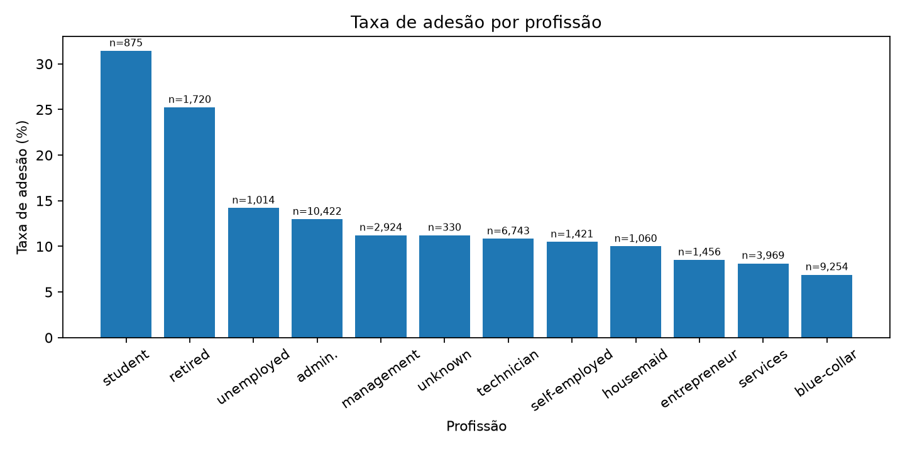
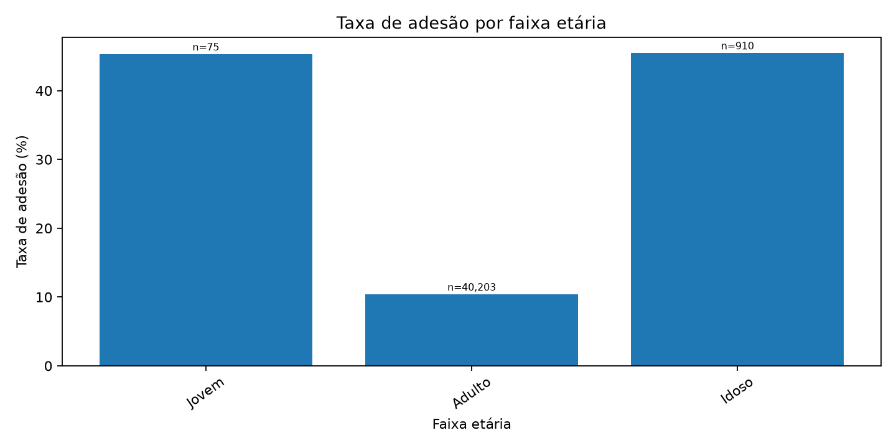
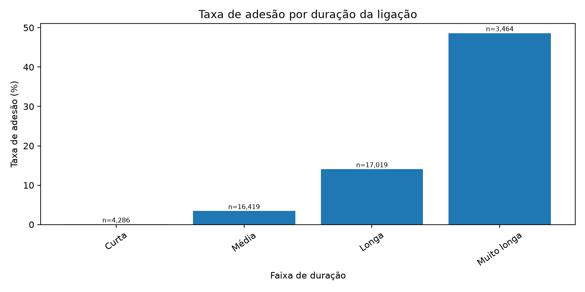
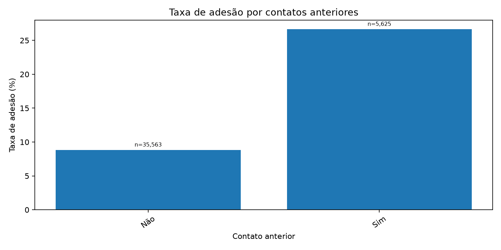

# Bank Marketing Analytics

Análise exploratória de dados de campanhas telefônicas de marketing bancário, desenvolvida em Python. O objetivo é investigar quais características dos clientes e das campanhas aparecem associadas à adesão a depósitos a prazo.

> Projeto de estudo e portfólio. Os resultados são históricos e observacionais: associação não significa causalidade, e os resultados não garantem desempenho em campanhas atuais.

## Pergunta de negócio

Quais perfis de clientes e características de contato apresentam taxas de adesão diferentes, e como essas informações podem orientar a análise e o planejamento de campanhas futuras?

## Base de dados

O projeto utiliza `bank-additional-full.csv`, versão com 41.188 registros e 20 variáveis de entrada, além da variável-alvo `y`, do conjunto [Bank Marketing — UCI Machine Learning Repository](https://archive.ics.uci.edu/dataset/222/bank+marketing). A base contém dados de campanhas de uma instituição bancária portuguesa, realizadas entre maio de 2008 e novembro de 2010.


Citação dos dados: Moro, S., Rita, P., & Cortez, P. (2014). *Bank Marketing* [Dataset]. UCI Machine Learning Repository. https://doi.org/10.24432/C5K306.

## Resultados em destaque

- **Taxa Geral de Adesão:** **11,27%** sobre o total de 41.188 clientes.
- **Maior diferença isolada (`poutcome=success`):** Clientes com sucesso na campanha anterior registraram **65,11%** de conversão (contra 8,83% sem histórico anterior).
- **Canal de Contato:** Ligações por celular atingiram **14,74%** de adesão vs. **5,23%** por telefone fixo.
- **Sazonalidade Discrepante:** Meses como março (50,55%), dezembro (48,90%), setembro (44,91%) e outubro (43,87%) tiveram altíssima conversão, porém com baixo volume de ligações (entre 182 e 718 registros), enquanto maio concentrou **13.769 ligações** (33,4% da base) com apenas **6,43%** de adesão.
- **Idade vs. Aposentadoria:** A taxa geral de aposentados (25,23%) é fortemente impulsionada pela idade. Aposentados adultos têm **11,61%** de conversão (n = 1.042), enquanto aposentados idosos atingem **46,17%** (n = 678). O grupo Idoso consolidado (61+ anos) apresenta **45,49%** (n = 910).

## O que fazer com isso

1. **Investigar o histórico de relacionamento:** a diferença entre clientes com e sem contatos anteriores sugere que o histórico pode ajudar a organizar análises de segmentação. Antes de transformar isso em regra de campanha, verifique custos, tamanho dos grupos e resultados em dados mais recentes.
2. **Evitar decisões baseadas apenas em percentuais:** grupos como estudantes podem ter taxas altas, mas precisam ser avaliados também pelo volume de clientes e pelo número absoluto de adesões.
3. **Rever a estratégia de contatos repetidos:** compare a adesão por quantidade de contatos na campanha atual. Não presuma que aumentar tentativas cause maior conversão; contatos adicionais também podem refletir clientes mais difíceis de alcançar.
4. **Não usar a duração da ligação para selecionar clientes antes do contato:** essa informação só existe depois da chamada. Ela pode ajudar a analisar chamadas concluídas, mas não é uma variável disponível para priorização prévia.

Essas são hipóteses de trabalho para investigação, não recomendações causais ou garantias de retorno financeiro.

## Visualizações

### Taxa de adesão por profissão



### Taxa de adesão por faixa etária



### Taxa de adesão por duração da ligação



### Taxa de adesão por contatos anteriores



## Metodologia

- Preparação de variáveis derivadas para faixas etárias, duração, contatos anteriores e grupos exploratórios de profissão.
- Análise descritiva de taxas de adesão e contagens por grupo.
- Testes qui-quadrado e V de Cramér para associações entre variáveis categóricas e adesão.
- Exploração de indicadores econômicos e correlações entre eles. Como os indicadores se repetem entre registros de clientes, essas análises são tratadas como exploratórias.
- Regressão logística regularizada como análise complementar. As variáveis numéricas `age`, `campaign` e `previous` são padronizadas com `StandardScaler`; as variáveis categóricas são representadas por dummies 0/1.

### Limitações do modelo

- `duration` foi excluída para evitar vazamento de informação.
- `pdays_was_999` foi excluída do modelo por carregar informação muito próxima de `previous` e `poutcome`. Essas duas variáveis mantidas também descrevem aspectos relacionados do histórico de campanhas, então seus coeficientes podem apresentar instabilidade por colinearidade.
- Odds ratios são associações ajustadas, não efeitos causais. Para variáveis numéricas padronizadas, o OR corresponde a uma variação de um desvio-padrão; para variáveis dummy, compara a categoria indicada com a categoria de referência.
- O modelo usa regularização L2 e não apresenta valores-p nem intervalos de confiança. Não foi desenvolvido como modelo preditivo validado.
- O agrupamento `job_group` é uma simplificação exploratória: Administrativo (`admin.`, `management`), Técnico / negócios (`entrepreneur`, `technician`, `self-employed`), Operacional (`blue-collar`, `services`, `housemaid`) e Outros (`retired`, `student`, `unemployed`, `unknown`). Não é uma classificação ocupacional oficial.
- Cada odds ratio de uma variável categórica compara a categoria com a **categoria de referência**, que é a primeira em ordem alfabética (por exemplo, `poutcome_success` é comparado com `failure`, e os meses com abril). As referências são impressas na saída do script e do notebook.
- A tabela de odds ratios inclui o `n` de cada categoria. Categorias com menos de 30 registros (por exemplo, `default_yes`, com 3) são marcadas com `n<30` e seus OR não devem ser interpretados.
- O modelo não inclui os indicadores econômicos e a base não tem ano, então os coeficientes de `month` absorvem diferenças de período.

## Estrutura

```text
bank-marketing-analytics/
├── analysis.ipynb
├── main.py
├── pytest.ini
├── README.md
├── requirements.txt
├── LICENSE
├── .gitignore
├── data/
│   └── bank-additional-full.csv
├── reports/
│   └── figures/             # gráficos finais versionados
├── src/
│   ├── __init__.py
│   └── bank_marketing_analysis.py
├── tests/
│   └── test_analysis.py
└── .github/workflows/
    └── tests.yml
```

## Como executar

Requer Python 3.10 ou superior.

```bash
git clone https://github.com/henrimoreira/bank-marketing-analytics.git
cd bank-marketing-analytics
python -m venv .venv
```

Ative o ambiente virtual:

- Windows PowerShell: `.venv\Scripts\Activate.ps1`
- macOS/Linux: `source .venv/bin/activate`

Instale as dependências e execute:

```bash
python -m pip install --upgrade pip
pip install -r requirements.txt
python main.py
```

Para executar os testes:

```bash
pytest -q
```

Para explorar a análise passo a passo, abra `analysis.ipynb` no VS Code ou Jupyter Notebook.

## Licenças

O código deste projeto está sob a licença MIT (consulte `LICENSE`). O conjunto de dados do UCI é disponibilizado separadamente sob **Creative Commons Attribution 4.0 International (CC BY 4.0)**, conforme indicado na página oficial. A licença do código não substitui nem altera a licença dos dados.

## Tecnologias

Python · Pandas · NumPy · Matplotlib · Seaborn · SciPy · scikit-learn · Jupyter · pytest
